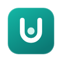
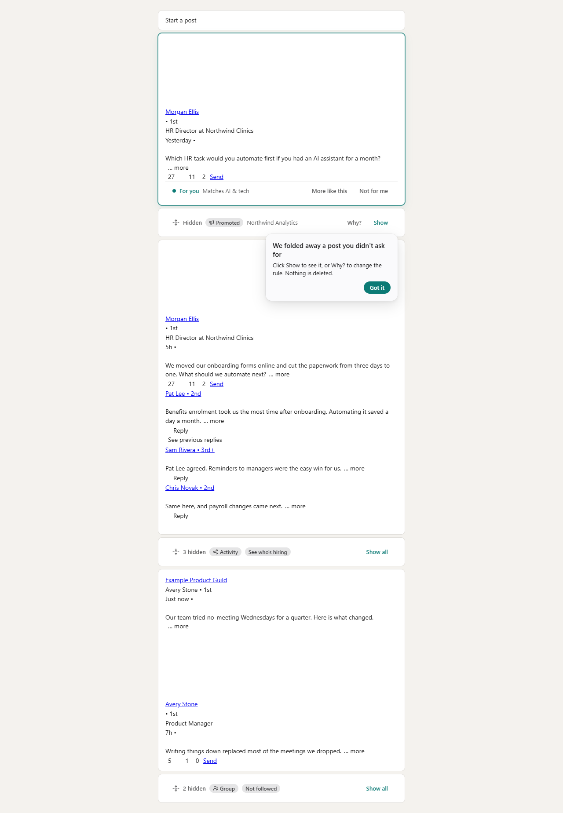
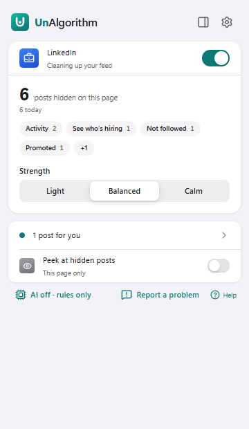
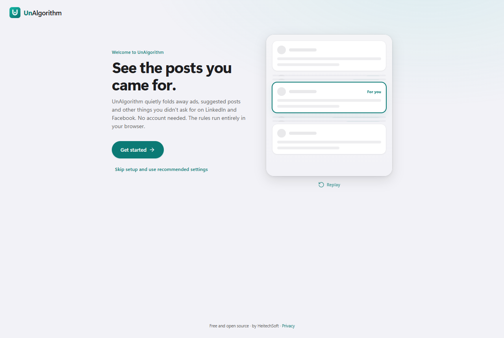

<p align="center">
  
</p>

<h1 align="center">UnAlgorithm Feed</h1>

<p align="center"><strong>See the posts you came for.</strong><br />
An open-source browser extension by HeitechSoft that quietly folds away ads, suggested posts and other noise on LinkedIn
and Facebook.</p>

<p align="center"><a href="https://unalgorithmfeed.com/">unalgorithmfeed.com</a> ·
<a href="https://unalgorithmfeed.com/help/">Help</a> ·
<a href="https://unalgorithmfeed.com/privacy/">Privacy</a></p>

<p align="center">
  <a href="LICENSE"></a>
  
  
</p>

---

Social feeds are ranked to keep you scrolling. They mix in ads, posts "suggested for you", "Jane liked this"
activity, and content from people you never chose to follow. **UnAlgorithm Feed (UnAlgorithm for short) hides that
noise and leaves a thin line in its place**, so you can still peek, and it never touches the posts from people you
actually follow.

<p align="center"></p>

## What it does

| | |
|---|---|
| **Hides the noise, no setup** | Ads (Promoted/Sponsored), suggested posts, network activity, feed panels like People You May Know, groups you haven't joined and, on LinkedIn, people and pages you don't follow (Facebook: in Calm, for now). Works with zero configuration and **makes no network requests at all**. |
| **Three strengths** | *Light* (just the clutter), *Balanced* (what you didn't ask for), *Calm* (only what matters). Change it from the toolbar; the feed updates live. |
| **Always explains itself** | Every hidden post has **Why?**: what was detected, and one-click fixes like "Always show this person" or "Stop hiding suggested posts", with Undo. |
| **For you** | Pick a few interests and matching posts get a quiet highlight. Works with simple keyword matching, or with AI if you turn it on. |
| **Optional AI, your choice** | Spot off-topic posts, engagement bait and rage bait with **Chrome's built-in on-device AI** (free, private), **your own API key** (Anthropic, OpenAI, Gemini, OpenRouter, Groq), or **a local or self-hosted model** (Ollama, LM Studio, any OpenAI-compatible server). |
| **Private by design** | Rules run in your browser. When AI is on, only what's needed to classify a post goes to the AI you chose: its text (with emails, phone numbers, @mentions and tagged names masked), the kind of media, a shared link's site and title, and your interests. Never author names, profile links, comments or images. Your API keys stay in this browser. No analytics, no tracking, no account. |
| **Fails open** | If a site changes its layout and detection looks wrong, UnAlgorithm stops hiding and tells you, rather than hiding posts by mistake. |

<p align="center">
  
  &nbsp;
  
</p>

## Install

UnAlgorithm is in **public preview**. Until it is on the Chrome Web Store, build it from source:

```bash
git clone https://github.com/HeitechSoft/unalgorithm.git
cd unalgorithm
npm i -g pnpm@10      # or: corepack enable
pnpm install
pnpm build
```

Then open `chrome://extensions`, turn on **Developer mode**, choose **Load unpacked**, and select
`apps/extension/.output/chrome-mv3`. A short setup opens in a new tab.

Requires Chrome (or another Chromium browser) 130 or newer. LinkedIn and Facebook must be in English for now.

## Status

| Platform | Status |
|---|---|
| LinkedIn | Ported from a tool used daily; tested against fixtures in LinkedIn's October 2026 feed structure. |
| Facebook | **Preview.** Detection is built and tested against synthetic fixtures; it needs captures from the live site before "people you don't follow" turns on by default. |
| AI | Anthropic, OpenAI and OpenAI-compatible servers work end to end. Chrome's on-device AI depends on your hardware and Chrome version. |

See [docs/ROADMAP.md](docs/ROADMAP.md) for what is next: UnAlgorithm Cloud (sync, hosted AI with pay-as-you-go
credits), fact-checking and "Other perspectives", more browsers and platforms.

## Develop

```bash
pnpm --filter @unalgorithm/extension exec playwright install chromium   # once
pnpm dev          # Chromium with the extension and hot reload, persistent profile (sign in to LinkedIn once)
pnpm dev:fb       # same, opening Facebook
pnpm test         # unit tests (Vitest)
pnpm e2e          # end-to-end tests: the built extension in Chromium against fixture pages, no live sites
pnpm check        # lint + typecheck + tests
```

The repo is a pnpm workspace:

| Path | What lives there |
|---|---|
| `apps/extension` | The WXT (Manifest V3) extension: background, content scripts, popup, side panel, settings, onboarding |
| `packages/platforms` | LinkedIn and Facebook adapters: how to find and read posts on each site, with fixtures |
| `packages/core` | Rules, presets, settings, the classification prompt and everything else that is pure TypeScript |
| `packages/ai` | AI clients (Anthropic, OpenAI, OpenAI-compatible, Chrome built-in) and the classify orchestrator |
| `packages/ui` | The design system: tokens, components, in-feed UI |
| `packages/protocol` | Wire contracts shared with the UnAlgorithm server |
| `apps/server` | The self-hostable server (Node, Hono, Postgres, Docker Compose): sign-in, AI labels, invites, caps, backups |

The extension can sign in to an UnAlgorithm server that you run for yourself, your family or your organization. To run
your own server, follow [docs/self-hosting.md](docs/self-hosting.md).

Read [docs/ARCHITECTURE.md](docs/ARCHITECTURE.md) first, then [CONTRIBUTING.md](CONTRIBUTING.md).
When a site changes its layout, [docs/adding-a-platform.md](docs/adding-a-platform.md) and
[docs/fixtures.md](docs/fixtures.md) explain how to capture fixtures and fix detection.

## Privacy

The short version: nothing leaves your browser unless you turn on AI, and then only what's needed to classify each
post goes to the AI you picked, never who wrote it. Read [PRIVACY.md](PRIVACY.md).

## License and trademarks

Copyright (C) 2026 HeitechSoft. UnAlgorithm is free software under the
[GNU Affero General Public License, version 3 only](LICENSE) (SPDX: `AGPL-3.0-only`). Contributions will be accepted
under the [Contributor License Agreement](CLA.md) once it is final. "UnAlgorithm Feed", "UnAlgorithm", "UnAlgo" and
the logo are trademarks of HeitechSoft; see [TRADEMARKS.md](TRADEMARKS.md) if you fork, and [docs/brand.md](docs/brand.md)
for how to write the name. Maintainers are listed in [MAINTAINERS.md](MAINTAINERS.md).

UnAlgorithm Feed is not affiliated with, endorsed by, or sponsored by LinkedIn or Meta. LinkedIn and Facebook are
trademarks of their respective owners.

Made by [HeitechSoft](https://heitechsoft.com) in Ontario, Canada.
